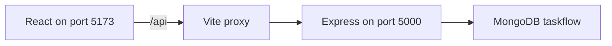

<<<<<<< HEAD
# TaskFlow

TaskFlow is a personal Kanban task manager built as a MERN application. A signed-in user creates tasks, moves them across To-Do, In-Progress, and Done, and can only see their own work. Sign-in is by email and password or by Google.

The repository folder is `StatusBoard`. The product name in the interface is TaskFlow.

## Contents

- [What this project includes](#what-this-project-includes)
- [Features](#features)
- [Tech stack](#tech-stack)
- [Requirements](#requirements)
- [Installation](#installation)
- [MongoDB](#mongodb)
- [Google sign-in](#google-sign-in)
- [How to run](#how-to-run)
- [Application flows](#application-flows)
- [Environment variables](#environment-variables)
- [Project structure](#project-structure)
- [API reference](#api-reference)
- [Design decisions](#design-decisions)
- [Possible improvements](#possible-improvements)
- [Deployment](#deployment)

## What this project includes

| Area | Delivered behavior |
| --- | --- |
| Accounts | Register, log in, log out, and restore the session on refresh |
| Google | Continue with Google creates an account on first use and signs that user in afterward |
| Tasks | Create, read, update, change status, and delete, scoped to the signed-in user |
| Board | Three columns, search by title, status counts, drag and drop, and a Move to menu |
| Security | Passwords hashed with bcrypt, JWT for 7 days, Joi validation, Helmet, and a rate limit on auth routes |
| Privacy | A task that belongs to someone else returns 404, the same as a missing task |

## Features

- Email registration and login, with client-side checks and show/hide password
- Google sign-in on both the login and register pages
- Protected dashboard and public auth pages
- New task, edit, and delete with a confirmation dialog
- Drag a card between columns, or move it with the status menu
- Search by title, per-status counters, loading skeletons, and empty columns
- Error toasts for failed requests, and success toasts for auth and task changes
- Responsive board: three columns on a wide screen, horizontal scroll on a tablet, stacked columns on a phone

## Tech stack

| Layer | Choice |
| --- | --- |
| Database | MongoDB with Mongoose |
| API | Express.js, Node.js 18+ |
| Auth | JSON Web Tokens, bcrypt, Google Identity Services |
| Validation | Joi on the server, matching checks on the forms |
| Client | React 18, Vite, React Router, Axios |
| UI | Plain CSS with design tokens, Inter, Lucide icons, react-hot-toast |
| Drag and drop | dnd-kit |

## Requirements

Install these before the first run:

| Requirement | Version / notes |
| --- | --- |
| Node.js | 18 or newer. Check with `node -v`. |
| npm | Comes with Node.js. Check with `npm -v`. |
| MongoDB | Local server on port 27017, or a MongoDB Atlas cluster |
| Browser | A current Chrome, Edge, or Firefox build |
| Google Cloud project | Only if you want Continue with Google. Email login works without it. |

MongoDB must be running before the API starts. The API exits if `MONGO_URI` or `JWT_SECRET` is missing.

## Installation

Open PowerShell in the project folder (`StatusBoard`).

1. Install dependencies for the root, the API, and the client:

```powershell
npm run install:all
```

2. Create the env files if they are not already present:

```powershell
Copy-Item server\.env.example server\.env
Copy-Item client\.env.example client\.env
```

Local copies of `server/.env` and `client/.env` are already in this workspace. On a new machine, copy the examples and fill them in. `.env` files are gitignored.

3. Confirm `server/.env` points at your database. For MongoDB on this computer:

```text
MONGO_URI=mongodb://localhost:27017/taskflow
```

`localhost` and `127.0.0.1` are the same machine. The database name is `taskflow`. You do not create that database yourself. The API creates it on the first register or task save.

4. Leave `JWT_SECRET` as a long random string. Do not ship the sample value to production.

5. Optional: add the Google client ID. See [Google sign-in](#google-sign-in).

## MongoDB

### Local

1. Start MongoDB. If it is a Windows service it may already be listening. Otherwise run `mongod`.
2. In MongoDB Compass, connect to `mongodb://localhost:27017/`.
3. After you register in the app, refresh Compass. You should see the `taskflow` database, a `users` collection, and a `tasks` collection.
4. Passwords in `users` are bcrypt hashes. They will not match the password you typed.

### Atlas

1. Create a free cluster, a database user, and a network access rule that allows your IP.
2. Copy the connection string and set it in `server/.env`:

```text
MONGO_URI=mongodb+srv://<user>:<password>@<cluster>.mongodb.net/taskflow?retryWrites=true&w=majority
```

3. Restart the API.

## Google sign-in

Email login does not need this section. Continue with Google does.

1. In Google Cloud Console, open APIs & Services, then Credentials.
2. Create an OAuth client ID of type **Web application**. The client name (for example `status board`) is only a label in the console.
3. Under **Authorized JavaScript origins**, add `http://localhost:5173`.
4. This app does not use a redirect URI. You can leave **Authorized redirect URIs** empty.
5. If the consent screen is in testing, add your Gmail address as a test user.
6. Put the same client ID in both env files:

```text
GOOGLE_CLIENT_ID=your-id.apps.googleusercontent.com
```

```text
VITE_GOOGLE_CLIENT_ID=your-id.apps.googleusercontent.com
```

7. Restart `npm run dev`. The login and register pages then show Google's own button.

## How to run

From the project folder, with MongoDB already running.

**API and client together**

```powershell
npm run dev
```

| Process | URL |
| --- | --- |
| API | http://localhost:5000 |
| Client | http://localhost:5173 |

The client proxies `/api` to port 5000, so the browser does not need a CORS exception in development. A successful API log contains `MongoDB connected` and `Server running on port 5000`.

**Separately, in two PowerShell windows**

```powershell
npm run server
```

```powershell
npm run client
```

The client calls `/api`. Start the API as well, or the board cannot load.

**Production-style commands**

```powershell
npm start --prefix server
npm run build --prefix client
```

## Application flows

### Request path



### Sign up with email

1. Open http://localhost:5173. The app sends `/` to `/dashboard`.
2. There is no token, so the dashboard redirects to `/login`.
3. Choose **Create an account**.
4. The form requires a name (2–50 characters), a valid email, a password of at least 6 characters, and a matching confirmation.
5. `POST /api/auth/register` hashes the password, stores the user, and returns a JWT.
6. The client saves the token and opens the dashboard.
7. A duplicate email returns 409.

### Sign in with email

1. Submit email and password on `/login`.
2. `POST /api/auth/login` checks the hash and returns a JWT.
3. A wrong password returns 401, `Invalid email or password`.
4. An account that was created only with Google returns 401 and asks the user to continue with Google.

### Continue with Google

The same button is on Login and Register.

1. Google returns an ID token to the browser.
2. The client posts it to `POST /api/auth/google`.
3. The API verifies the token and the email.
4. If that Google account or email is new, the API creates a user with no password and returns 201.
5. If the user already exists, the API signs them in and returns 200.
6. If the email already belongs to a password account, the Google id is stored on that same user.
7. The client stores the JWT and opens the dashboard.

### Session

1. The JWT is kept in `localStorage` under `taskflow_token`.
2. On load, the client calls `GET /api/auth/me`.
3. A valid token restores the user and stays on the dashboard.
4. A missing or expired token returns the user to `/login`.
5. Log out clears the token and the task list, then opens `/login`.
6. `/login` and `/register` redirect to `/dashboard` when a session already exists.

### Tasks

1. The dashboard loads `GET /api/tasks` for the signed-in user only.
2. **New Task** opens a modal. Title is required (max 100). Description is optional (max 500). Status defaults to To-Do.
3. Edit opens the same modal with the current values and sends `PUT /api/tasks/:id`.
4. Delete asks for confirmation, then sends `DELETE /api/tasks/:id`.
5. Dragging a card to another column, or changing **Move to**, sends `PATCH /api/tasks/:id/status`.
6. The card moves immediately. If the request fails, it returns to the previous column and a toast explains the error.
7. Search filters the visible cards by title. It does not delete anything.
8. Each column shows its count. An empty column says "No tasks here yet".

### Ownership

Every task query includes the logged-in user's id. Another user who knows a task id still gets 404 on read, update, and delete. Their own `GET /api/tasks` list does not include that task.

## Environment variables

### Server (`server/.env`)

| Variable | Required | Purpose |
| --- | --- | --- |
| `PORT` | No | API port. Default `5000`. |
| `MONGO_URI` | Yes | MongoDB connection string, including the database name `taskflow`. |
| `JWT_SECRET` | Yes | Secret used to sign tokens. Use a long random value in production. |
| `JWT_EXPIRES_IN` | No | Token lifetime. Default `7d`. |
| `CLIENT_URL` | No | Browser origin allowed by CORS. Default `http://localhost:5173`. |
| `NODE_ENV` | No | `development` or `production`. Stack traces are hidden in production. |
| `GOOGLE_CLIENT_ID` | For Google only | OAuth web client ID. Same value as the client variable below. |

### Client (`client/.env`)

| Variable | Required | Purpose |
| --- | --- | --- |
| `VITE_API_URL` | No | Axios base URL. Use `/api` in development so the Vite proxy is used. |
| `VITE_GOOGLE_CLIENT_ID` | For Google only | Same Google client ID as `GOOGLE_CLIENT_ID`. |

Restart `npm run dev` after changing either file. Vite only reads `VITE_` variables at startup.

## Project structure

```
StatusBoard/
  package.json              install:all, dev, server, client
  client/                   React app, port 5173
    src/api/                Axios instance, auth header, 401 handling
    src/components/         Navbar, board, modal, forms, Google button
    src/context/            Auth and task state
    src/hooks/              useAuth, useTasks
    src/pages/              Login, Register, Dashboard, 404
    src/styles/global.css   Colors, type, and spacing tokens
  server/                   Express API, port 5000
    config/                 MongoDB connection
    controllers/            Auth and tasks
    middleware/             JWT, Joi wrapper, 404, errors
    models/                 User and Task
    routes/
    utils/
    validators/
```

## API reference

Responses are JSON.

Success:

```json
{ "success": true }
```

Error:

```json
{ "success": false, "message": "What went wrong", "errors": [{ "field": "email", "message": "Please provide a valid email" }] }
```

`errors` is present for validation failures. Passwords are never returned.

Protected routes need:

```http
Authorization: Bearer <token>
```

| Code | When |
| --- | --- |
| 200 | Read, update, delete, or login succeeded |
| 201 | User or task created |
| 400 | Validation failed, including an invalid task id |
| 401 | Missing, invalid, or expired token, or bad credentials |
| 404 | Unknown route, or a task that is missing or not owned by this user |
| 409 | Email already registered, or a Google account conflict |
| 500 | Unexpected failure, or Google sign-in is not configured |

Auth routes are rate limited.

### Health

`GET /api/health`

```json
{ "success": true, "message": "OK" }
```

### Register

`POST /api/auth/register`

```json
{ "name": "Ada Lovelace", "email": "ada@example.com", "password": "secret1" }
```

`201`

```json
{
  "success": true,
  "token": "<jwt>",
  "user": {
    "id": "652f...",
    "name": "Ada Lovelace",
    "email": "ada@example.com",
    "createdAt": "2026-10-13T00:00:00.000Z"
  }
}
```

### Log in

`POST /api/auth/login`

```json
{ "email": "ada@example.com", "password": "secret1" }
```

`200` uses the same `{ success, token, user }` shape.

### Google

`POST /api/auth/google`

```json
{ "credential": "<Google ID token>" }
```

`201` when the account is new. `200` when it already exists.

```json
{
  "success": true,
  "created": true,
  "token": "<jwt>",
  "user": {
    "id": "652f...",
    "name": "Ada Lovelace",
    "email": "ada@example.com",
    "createdAt": "2026-10-13T00:00:00.000Z"
  }
}
```

### Current user

`GET /api/auth/me`

```json
{
  "success": true,
  "user": {
    "id": "652f...",
    "name": "Ada Lovelace",
    "email": "ada@example.com",
    "createdAt": "2026-10-13T00:00:00.000Z"
  }
}
```

### List tasks

`GET /api/tasks`

Optional filter: `GET /api/tasks?status=In-Progress`

`status` must be `To-Do`, `In-Progress`, or `Done`.

```json
{
  "success": true,
  "count": 1,
  "data": [
    {
      "_id": "6530...",
      "title": "Write the brief",
      "description": "First draft",
      "status": "To-Do",
      "user": "652f...",
      "createdAt": "2026-10-13T00:00:00.000Z",
      "updatedAt": "2026-10-13T00:00:00.000Z"
    }
  ]
}
```

### Create a task

`POST /api/tasks`

```json
{ "title": "Write the brief", "description": "First draft", "status": "To-Do" }
```

`description` and `status` are optional. Status defaults to `To-Do`. `201` returns `{ "success": true, "data": { ...task } }`.

### Get one task

`GET /api/tasks/:id`

`200` returns `{ "success": true, "data": { ...task } }`. An id that is not 24 hex characters returns 400. A missing or foreign task returns 404.

### Update a task

`PUT /api/tasks/:id`

```json
{ "title": "Write the brief", "description": "Revised", "status": "In-Progress" }
```

Send at least one of `title`, `description`, or `status`.

### Update status

`PATCH /api/tasks/:id/status`

```json
{ "status": "Done" }
```

This is the call made by drag and drop and by the Move to menu.

### Delete a task

`DELETE /api/tasks/:id`

```json
{ "success": true, "message": "Task deleted" }
```

### Validation error

`400`

```json
{
  "success": false,
  "message": "Validation failed",
  "errors": [{ "field": "title", "message": "Title is required" }]
}
```

## Design decisions

- Development traffic goes to one origin. Vite forwards `/api` to port 5000. CORS still uses `CLIENT_URL` so a deployed client on another origin can call the API.
- Task access is filtered by user id. Returning 404 for someone else's task does not reveal that the id exists.
- A column move updates the screen first, then saves. A failed save puts the card back.
- Google sign-in verifies the ID token on the server. The browser never trusts the profile by itself.
- The JWT lives in `localStorage`. A 401 from a protected call clears it and returns the user to login.

## Possible improvements

- Store the JWT in an httpOnly cookie and add refresh tokens
- Save the order of cards inside a column
- Add API and UI tests
- Paginate a large task list
- Add shared boards and assignees

## Deployment

### API on Render

- Web Service, root directory `server`
- Build command: `npm install`
- Start command: `npm start`
- Set environment variables in the Render dashboard (not in a committed `.env` file):
  - `MONGO_URI` must be the Atlas `mongodb+srv://...` string, with your real password and `/taskflow` after the host. Do not use `localhost` or `127.0.0.1`.
  - `JWT_SECRET`, `JWT_EXPIRES_IN=7d`, `CLIENT_URL` (the deployed site origin), `GOOGLE_CLIENT_ID`, `NODE_ENV=production`
- In Atlas Network Access, allow `0.0.0.0/0` so Render can connect.

### Client on Render (Static Site)

- Root directory `client`
- Build command `npm install && npm run build`
- Publish directory `dist`
- `VITE_API_URL` = `https://<your-api>.onrender.com/api`
- `VITE_GOOGLE_CLIENT_ID` = the same Google client ID
- Rewrite `/*` to `/index.html`
- Add the static-site origin to Google Authorized JavaScript origins and to the API `CLIENT_URL`
